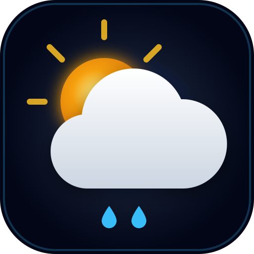

# 🌦️ AuraWeather — Real-Time Atmospheric Intelligence

<div align="center">



### A next-generation, cross-platform meteorological dashboard featuring dynamic procedural canvas weather effects, live air quality index, solar trajectory tracking, and Progressive Web App (PWA) offline capabilities.

[](LICENSE)
[](manifest.json)
[](https://open-meteo.com/)
[](#-design-system--aesthetics)
[](vercel.json)

[Features](#-key-features) • [Tech Stack](#-technology-stack) • [Learning Outcomes](#-learning-outcomes--engineering-takeaways) • [Project Structure](#-project-structure) • [Getting Started](#-getting-started) • [Deployment](#-deployment)

</div>

---

## 🌟 Overview

**AuraWeather** is an atmospheric weather platform built from first principles using pure web technologies (HTML5, Vanilla CSS3, and JavaScript ES6+). It eliminates cumbersome build tools, external frameworks, and bloated dependencies, delivering a lightweight, 60 FPS experience across all desktop, tablet, and mobile devices.

Powered by the high-precision **Open-Meteo APIs**, AuraWeather provides global real-time weather metrics, comprehensive 24-hour hourly trendlines, 7-day extended forecasts with visual temperature gradient ranges, and live environmental air quality metrics (US AQI, PM2.5, PM10).

---

## ✨ Key Features

### 🌌 Procedural Weather Canvas Simulation
* **Live Atmospheric Particles (60 FPS)**: An HTML5 Canvas particle engine dynamically simulates the current weather state:
  * ☀️ **Clear Day**: Shimmering solar motes with warm pulsing coronal light.
  * 🌙 **Starry Night**: Twinkling starfield with periodic shooting stars.
  * 🌧️ **Rain & Showers**: Slanted raindrops with surface splash physics scaled to wind speed.
  * ⚡ **Thunderstorm**: Heavy rain combined with randomized atmospheric lightning flashes.
  * ❄️ **Snow & Flurries**: Soft sinusoidal snowflake drift with flutter physics.
  * 🌫️ **Fog & Overcast**: Drifting low-opacity vapor clouds.
* **Reduced-Motion Friendly**: Automatic detection of `prefers-reduced-motion` and a dedicated manual toggle switch.

### 📊 Real-Time Atmospheric Intelligence
* **Current Weather Hero**: Displays real-time temperature, "feels like" apparent temperature, daily min/max, condition badges, and local time calculated from the destination's timezone.
* **US Air Quality Index (AQI)**: Live tracking of particulate matter (PM2.5, PM10) with color-coded safety tiers (Good, Moderate, Sensitive, Unhealthy, Hazardous).
* **Bézier Solar Trajectory**: Interactive sun arc tracking daylight progress between sunrise and sunset along a mathematical quadratic curve.
* **Dynamic Wind Compass**: Live wind speed, gust readings, and a compass arrow rotating according to wind direction degrees.
* **UV Index & Barometric Pressure**: Real-time UV intensity gauge with sun safety advisories, and atmospheric pressure equilibrium monitoring.

### 📅 Extended Outlooks & Trends
* **24-Hour Hourly Timeline**: Smooth, touch-scrollable timeline displaying hourly temperatures, weather condition icons, and precipitation probability percentages.
* **7-Day Weekly Outlook**: Weekly forecast featuring responsive temperature range bars displaying the daily spread against the full 7-day range.
* **Smart Lifestyle Outlook**: Dynamic algorithmic recommendations for outdoor fitness, appropriate attire, and skin sun protection.

### 📱 Cross-Platform & Mobile First
* **PWA (Progressive Web App)**: Installable as a native app on iOS (Add to Home Screen) and Android with standalone display mode.
* **Offline Caching**: Built-in Service Worker (`sw.js`) utilizing a *Network-First with Cache Fallback* strategy for weather data and *Stale-While-Revalidate* for static assets.
* **Dynamic Viewport (`100dvh`) & Safe Areas**: Accommodates modern iPhone notches, Dynamic Island, and Android gesture navigation bars.
* **Zero Tap Delay**: `touch-action: manipulation` eliminates the 300ms mobile tap delay.

### 🔍 Search, Favorites & Preferences
* **Debounced Global Autocomplete**: Live search for cities, regions, and countries worldwide.
* **Geolocation ("My Location")**: One-tap GPS coordinate detection.
* **Persistent Favorites**: Pin favorite cities to the quick-access chips bar with `localStorage` persistence.
* **Dual Units Support**: Instant toggle between Metric (°C, km/h, mm) and Imperial (°F, mph, in) without needing to re-fetch data.

---

## 🛠️ Technology Stack

| Layer | Technologies Used | Description |
| :--- | :--- | :--- |
| **Structure** | HTML5 (Semantic & Accessible) | Semantic elements (`<header>`, `<main>`, `<section>`, `<article>`, `<aside>`), ARIA attributes, and OpenGraph metadata. |
| **Styling** | Vanilla CSS3 (Custom Design System) | Modern CSS variables, glassmorphism (`backdrop-filter`), fluid typography (`clamp()`), and multi-tier responsive breakpoints. |
| **Logic** | JavaScript (ES6+ Vanilla) | Async/await, Web APIs (`fetch`, `Canvas 2D Context`, `Geolocation API`, `localStorage`, `Intl.DateTimeFormat`). |
| **Graphics** | HTML5 Canvas & Inline Vector SVGs | Lightweight 60 FPS procedural particle animation engine and crisp, resolution-independent weather vector icons. |
| **PWA & Offline** | Service Worker (`sw.js`) & Manifest | Offline caching, installation support, and homescreen integration. |
| **Meteorological APIs** | [Open-Meteo Free APIs](https://open-meteo.com/) | Weather Forecast API, Geocoding Search API, and Atmospheric Air Quality API. |
| **Hosting** | Vercel | Zero-configuration static edge deployment with custom caching headers (`vercel.json`). |

---

## 💡 Learning Outcomes & Engineering Takeaways

Developing AuraWeather provided valuable practical experience across core software and frontend engineering disciplines:

### 1. Mathematical Modeling & Procedural Canvas Rendering
* Implemented particle systems using vector mathematics, velocity dampening, and boundary checks.
* Simulated realistic sinusoidal flutter (`Math.sin(offset) * amp`) for snowflakes and wind-slanted geometry for rainfall.
* Computed sun position along a 2D Quadratic Bézier curve:
  $$\mathbf{B}(t) = (1-t)^2\mathbf{P}_0 + 2(1-t)t\mathbf{P}_1 + t^2\mathbf{P}_2, \quad t \in [0, 1]$$
  where $t$ represents daylight progression calculated between sunrise and sunset timestamps.

### 2. Progressive Web App (PWA) Lifecycle & Offline Strategies
* Engineered a Service Worker with dual caching strategies:
  * **Cache-First / Stale-While-Revalidate**: For static shell resources (CSS, icons, JS, manifest).
  * **Network-First with Fallback**: For live weather API calls, ensuring the user sees the latest data online while preserving the last known forecast when offline.

### 3. Glassmorphic Design Systems & Modern Responsive Architecture
* Built a design system leveraging CSS custom properties, backdrop blur filters, and specular border highlights.
* Handled modern mobile constraints including dynamic viewport heights (`100dvh` vs `100vh`), notch/pill safe-area insets (`env(safe-area-inset-*)`), and touch target accessibility (minimum 44x44px).
* Implemented fluid typography using `clamp(min, preferred, max)` to ensure proportional scaling from compact smartphones (320px) to ultrawide monitors (2560px+).

### 4. Resilient Asynchronous Data Management
* Coordinated multiple parallel asynchronous network requests (`Promise.all`) fetching both meteorological forecast and air quality telemetry concurrently.
* Integrated a debounced search input pipeline with abort/timeout safeguards to minimize unnecessary network traffic while maintaining responsive autocomplete.
* Designed client-side unit transformation algorithms converting temperatures, wind speeds, pressures, and precipitation volumes in-memory without repetitive network calls.

---

## 📁 Project Structure

```plaintext
aura-weather/
├── css/
│   └── style.css           # Design tokens, glassmorphism, animations & media queries
├── js/
│   ├── api.js              # Open-Meteo API layer, WMO code interpretation & conversions
│   ├── app.js              # State management, DOM controller & event listeners
│   ├── canvas-weather.js   # 60 FPS procedural atmospheric particle engine
│   └── icons.js            # Inline animated vector SVG weather icons
├── icon.svg                # Master vector app icon & PWA icon
├── index.html              # Accessible, semantic HTML5 structure & PWA meta tags
├── manifest.json           # Web App Manifest for mobile & desktop installation
├── package.json            # Project metadata & local dev scripts
├── sw.js                   # Service Worker for offline resilience & caching
├── vercel.json             # Vercel edge deployment configuration & HTTP headers
├── .gitignore              # Git ignore rules for clean repository hygiene
├── LICENSE                 # MIT License
└── README.md               # Project documentation
```

---

## 🚀 Getting Started

### Prerequisites
* Any modern web browser (Google Chrome, Apple Safari, Mozilla Firefox, Microsoft Edge).
* (Optional) Python 3, Node.js, or any static file server for local testing.

### Local Setup

1. **Clone the repository**:
   ```bash
   git clone https://github.com/Rajinikanth0079/aura-weather.git
   cd aura-weather
   ```

2. **Run a local development server**:
   * **Using Python**:
     ```bash
     python -m http.server 8080
     ```
   * **Using Node.js (`npx`)**:
     ```bash
     npx serve .
     ```

3. **Open the application**:
   Visit [http://localhost:8080](http://localhost:8080) in your web browser.

---

## ☁️ Deployment

### Deploying to Vercel

AuraWeather includes a ready-to-use [`vercel.json`](vercel.json) configuration.

#### Option A: Using Vercel CLI (Fastest)
```bash
# Install and run Vercel CLI
npx vercel

# Deploy to production
npx vercel --prod
```

#### Option B: Using GitHub Integration
1. Push this repository to your GitHub account.
2. Log in to [Vercel](https://vercel.com) and click **"New Project"**.
3. Import the `aura-weather` repository.
4. Keep the default settings (Root directory: `./`, Framework: `Other`) and click **Deploy**.

---

## 📄 License

This project is open-source and distributed under the **[MIT License](LICENSE)**.

---

## 👏 Acknowledgments

* Weather and environmental telemetry provided by the [Open-Meteo Project](https://open-meteo.com/) (Free for non-commercial open data).
* Typography by [Google Fonts](https://fonts.google.com/) (*Outfit* & *Plus Jakarta Sans*).

<div align="center">
Made with ❤️ by <a href="https://github.com/Rajinikanth0079">Rajinikanth</a>
</div>
